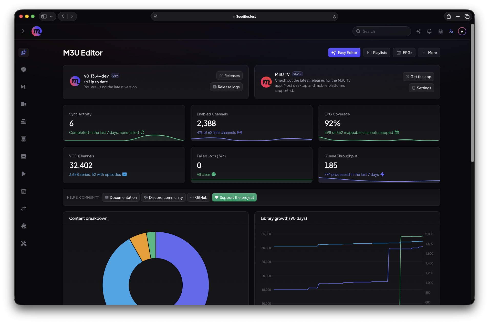
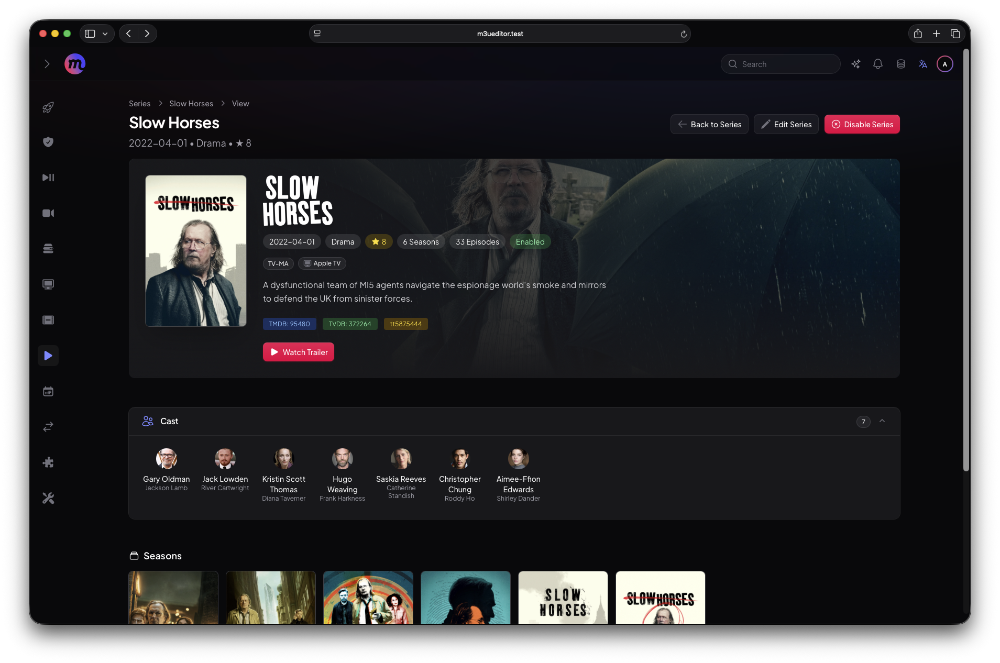
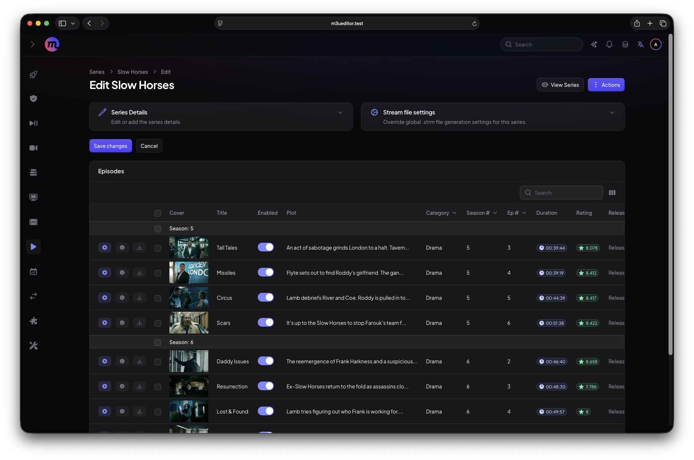
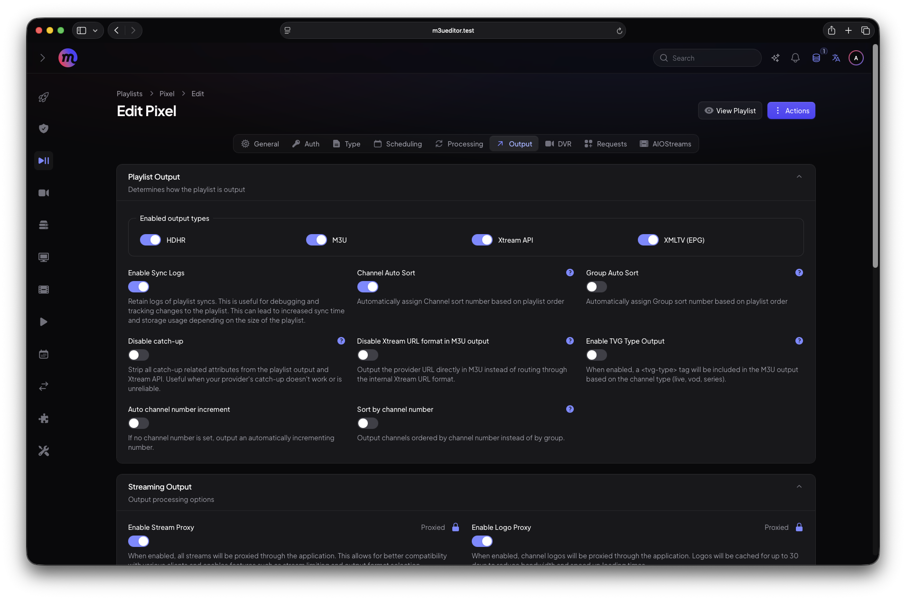
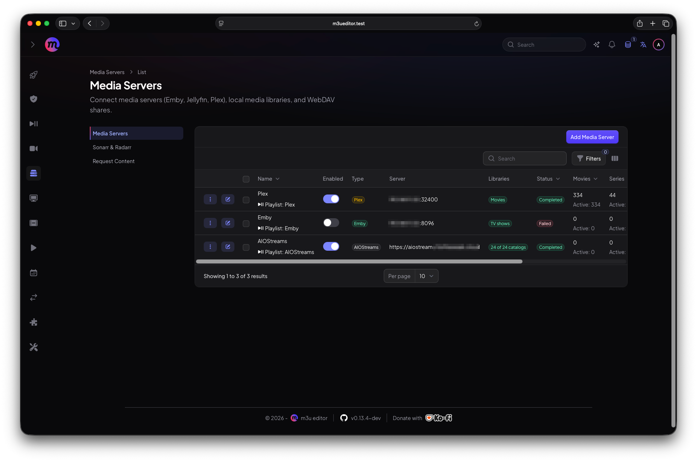
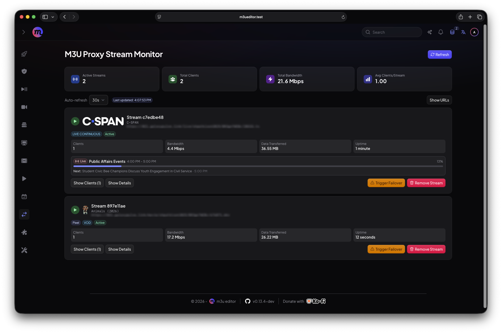
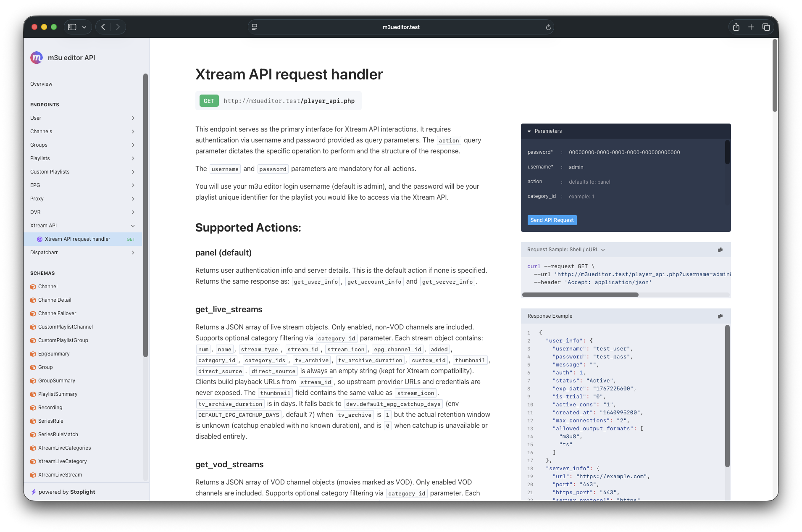

  

<h3>m3u editor</h3>

English | [中文](./README-ZH.md)

A full-featured and powerful `IPTV` editor, including features similar to **xteve** or **threadfin**. Also includes full `EPG` management, full Xtream API output, series management with ability to store and sync .strm files, post processing with ability to call custom scripts, send webhook requests, or send an email, and much more!

Works with m3u, m3u8, m3u+ and Xtream codes api!

EPG support for XMLTV files (local or remote), XMLTV URLs, and full **Schedules Direct** integration.

### Questions/issues/suggestions

Feel free to [open an issue](https://github.com/sparkison/m3u-editor/issues/new?template=bug_report.md) on this repo, or hit us up on [Discord](https://discord.gg/rS3abJ5dz7)

### Join us on Discord

Join our [Discord](https://discord.gg/rS3abJ5dz7) server to ask questions and get help, help others, suggest new ideas, and offer suggestions for improvements! You can also try out and help test new features! 🎉

## 🚀 How to run

### Managed Hosting

Fully managed **M3U Editor** instances available via [ElfHosted](https://store.elfhosted.com/product/m3u-editor/) – no setup required 🪄

- https://store.elfhosted.com/product/m3u-editor/

### Self hosted

#### Prerequisites

- [Docker](https://www.docker.com/) installed and setup on your system

#### 🐳 Docker quick start <small><code>v0.8.x+</code></small>
> [!IMPORTANT]
> - **Default Username:** admin
> - **Default password:** admin
> - **Default port:** 36400

| Use Case                    | File                                                    | Description                                                                                            |
| --------------------------- | ------------------------------------------------------- | ------------------------------------------------------------------------------------------------------ |
| **Modular Deployment**      | [docker-compose.proxy.yml](./docker-compose.proxy.yml)         | ⭐⭐ Recommended! Separate containers for **m3u-editor**, **m3u-proxy** (_the external proxy setup is required for hardware acceleration_), and **Redis** — perfect if you want more granular control (_Postgres and NGINX can be easily added as a seperate container as well_). |
| **Modular + VPN** | [docker-compose.proxy-vpn](./docker-compose.proxy-vpn.yml) | Example of modular deployment using Gluetun VPN.          |
| **All-in-One Deployment**   | [docker-compose.aio.yml](./docker-compose.aio.yml) | A simple, all-in-one solution — everything runs in a single container for quick setup (_hardware acceleration is not supported in this setup_).  |

### 🔥 Advanced docker setup <small><code>v0.8.x+</code></small>

| Use Case                    | File                                                    | Description                                                                                            |
| --------------------------- | ------------------------------------------------------- | ------------------------------------------------------------------------------------------------------ |
| **Fully Modular (Nginx)** | [docker-compose.external-all.yml](./docker-compose.external-all.yml) | Example of fully modular deployment with Nginx. See [External Services Setup](./docs/docker-compose.external-services.md) for full details and examples          |
| **Fully Modular (Caddy)** | [docker-compose.external-all-caddy.yml](./docker-compose.external-all-caddy.yml) | Example of fully modular deployment with Caddy (alternative to Nginx). Includes automatic HTTPS support.          |

View more in our [getting started](https://sparkison.github.io/m3u-editor-docs/docs/about/getting-started/) docs to get up and running in minutes! 🥳

---

## 📸 Screenshots

---

## 🤝 Want to Contribute?

> Whether it’s writing docs, squashing bugs, or building new features, your contribution matters! ❤️

We welcome **PRs, issues, ideas, and suggestions**!\
Here’s how you can join the party:

- Follow our coding style and best practices.
- Be respectful, helpful, and open-minded.
- Respect the **CC BY-NC-SA license**.

1. Fork the repository
2. Create a feature branch
3. Add tests for new functionality
4. Submit a pull request

---

## ⚖️ License  

> m3u editor is licensed under **CC BY-NC-SA 4.0**:  

- **BY**: Give credit where credit’s due.  
- **NC**: No commercial use.  
- **SA**: Share alike if you remix.  

For full license details, see [LICENSE](https://creativecommons.org/licenses/by-nc-sa/4.0/).
